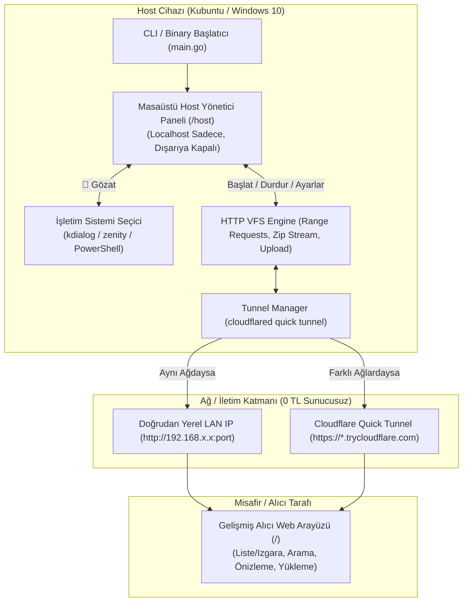

# PROJECT_ARCHITECTURE.md — folder-together

## 1. Genel Bakış ve Amaç
`folder-together`, farklı işletim sistemlerinde (Kubuntu Linux & Windows 10) ve farklı ağlarda (BT laboratuvarı, ev ağı, mobil veri, kampüs Wi-Fi) çalışan geliştiricilerin **hiçbir sunucu kiralamadan veya satın almadan (0 TL maliyet)** yüksek hızda ve stabil bir şekilde dosya/klasör paylaşmasını sağlayan bağımsız (single-binary) bir Go uygulamasıdır.

- **Teknoloji:** Go (Golang) 1.23
- **Platformlar:** Kubuntu / Linux (ELF amd64) ve Windows 10 (.exe x86_64)
- **Masaüstü Yönetici GUI:** Yerel Host Kontrol Paneli (`/host`) + İşletim Sistemi Yerel Klasör/Dosya Seçicileri (`kdialog` / `zenity` / PowerShell)
- **Alıcı Web Arayüzü:** Modern Vanilla HTML5/CSS3/JS, Liste/Izgara görünümü, anlık arama, tarayıcı içi dosya önizleme (resim/kod/video/ses), sürükle-bırak çoklu yükleme, dinamik zip akışı ve QR kod desteği
- **Ağ Katmanı:** Hibrit LAN (Yerel Ağ mDNS/IP) + Cloudflare Quick Tunnel (Zero-config ephemeral HTTPS)
- **Yerelleştirme (i18n):** Türkçe (TR) ve İngilizce (EN) çift dilli destek

---

## 2. Mimari Bileşenler ve Veri Akışı



---

## 3. Modül Detayları

### `cmd/main.go`
- İkili dosya çift tıklandığında veya argümansız çalıştırıldığında (`-gui` modu) arka planda sunucuyu başlatıp varsayılan tarayıcıda masaüstü kontrol panelini (`http://127.0.0.1:8080/host`) otomatik açar (`host.OpenBrowser`).
- Doğrudan terminalden argümanlarla (`-dir`, `-file`, `-pin`, `-upload`, `-no-browser`) başlatıldığında klasik CLI kullanımını da eksiksiz sürdürür.

### `internal/host/dialogs.go`
- **İşletim Sistemi Yerel Klasör Seçici (`PickFolder`):**
  - Kubuntu / KDE: `kdialog --getexistingdirectory`
  - GNOME / Linux: `zenity --file-selection --directory`
  - Windows 10: `powershell -Command "Add-Type -AssemblyName System.Windows.Forms; $f = New-Object Windows.Forms.FolderBrowserDialog; ..."`
- **İşletim Sistemi Yerel Dosya Seçici (`PickFile`):**
  - Kubuntu: `kdialog --getopenfilename`
  - Windows: `powershell OpenFileDialog`
- **Varsayılan Tarayıcı Açıcı (`OpenBrowser`):**
  - Linux: `xdg-open`
  - Windows: `rundll32 url.dll,FileProtocolHandler`

### `internal/server/server.go`
- **Host Yönetim API'leri (`/api/host/*`):** `localOnly` middleware'i ile yalnızca `127.0.0.1` (localhost) isteklerini kabul eder. Dışarıdan veya tünelden gelen istekleri `403 Forbidden` ile engeller.
- **Canlı Aktivite Günlüğü (`LogEvent`):** Bağlanan istemcileri, indirilen dosyaları, yüklenen içerikleri ve sistem durumlarını zaman damgasıyla bellekte tutar ve `/api/host/events` üzerinden sunar.
- **Tarayıcı İçi Önizleme (`/api/preview`):** Resim, metin/kod dosyaları, ses ve video için uygun MIME tipi ve UTF-8 başlıklarıyla güvenli önizleme sağlar.
- **Gömülü Varlıklar (`web/*`):** HTML, CSS ve JS dosyaları binary içerisine gömülüdür (`embed.FS`).

### `internal/server/web/`
- **`host.html` / `host.css` / `host.js`:** Masaüstü kontrol paneli (Klasör/dosya seçimi, PIN belirleme, yükleme izni, tünel açma/kapama, QR kod modalı ve canlı aktivite akışı).
- **`index.html` / `style.css` / `app.js`:** Alıcı web arayüzü (Liste & Izgara görünümü, dinamik anlık dosya arama, medya önizleme modalı, çoklu dosya yükleme ilerleme çubuğu, QR kod paylaşımı).

### `internal/tunnel/tunnel.go`
- **Tünel Orkestrasyonu (`StartQuickTunnel`):** Cloudflare Quick Tunnel ikilisini `--protocol http2` parametresiyle başlatarak kurumsal güvenlik duvarlarını aşar ve geçici HTTPS tüneli açar.
- **Otomatik URL Kısaltıcı (`ShortenURL`):** Uzun `*.trycloudflare.com` linkini `ulvis.net` / `clck.ru` üzerinden temiz, kısa (~20 karakter) bir yönlendirme linkine dönüştürür.

---

## 4. Dizin Yapısı

```
folder-together/
├── cmd/
│   └── main.go                  # Başlatıcı ve CLI / GUI modu kontrolü
├── internal/
│   ├── host/
│   │   └── dialogs.go           # İşletim sistemi yerel dosya seçicileri (kdialog/PowerShell)
│   ├── i18n/
│   │   └── i18n.go              # TR/EN çift dilli sözlük
│   ├── server/
│   │   ├── server.go            # HTTP dosya sunucusu, VFS, zip stream, upload, host APIs
│   │   └── web/                 # Gömülü arayüz dosyaları
│   │       ├── host.html        # Masaüstü host yönetici paneli
│   │       ├── host.css         # Yönetici paneli stilleri
│   │       ├── host.js          # Yönetici paneli istemci mantığı
│   │       ├── index.html       # Alıcı web arayüzü (Toolbar, Grid, Table, Preview)
│   │       ├── style.css        # Alıcı arayüzü ve ortak tasarım stilleri
│   │       └── app.js           # Alıcı arayüzü mantığı (Arama, önizleme, yükleme)
│   └── tunnel/
│       └── tunnel.go            # LAN IP ve Cloudflare Quick Tunnel yöneticisi
├── bin/
│   ├── folder-together-linux    # Kubuntu için tek binary (ELF)
│   └── folder-together-windows.exe # Windows 10 için tek binary (.exe)
├── Makefile                     # Çapraz derleme komutları
├── go.mod                       # Modül yapılandırması
├── README.md                    # Kullanıcı kılavuzu
└── PROJECT_ARCHITECTURE.md      # Bu mimari doküman
```
